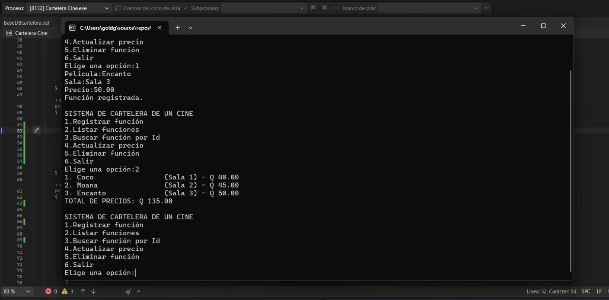
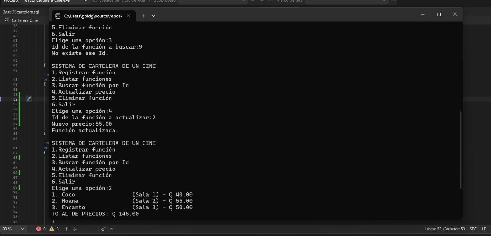
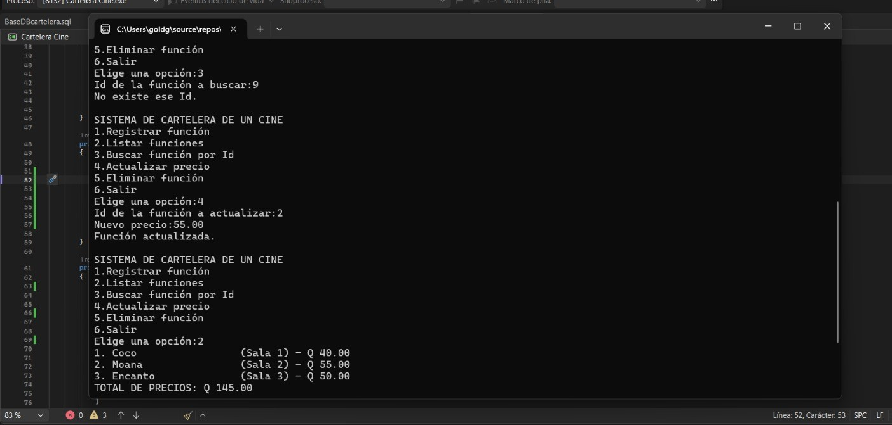
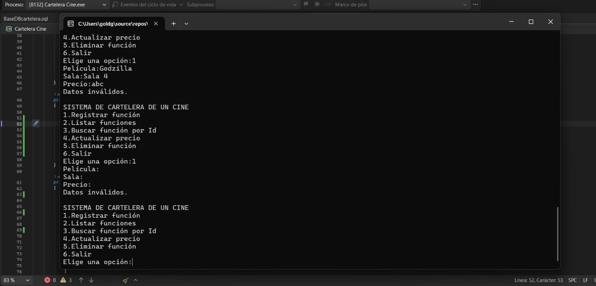

Sistema de Cartelera de un Cine

Aplicación de consola desarrollada en C# (.NET 8) utilizando ADO.NET y SQL Server LocalDB para la gestión de funciones de cine.

Requisitos Previos
Visual Studio Community con .NET 8 instalado.
Instancias de SQL Server LocalDB.

Pasos para Ejecutar
1.Base de Datos: Ejecute el script SQL ubicado en el repositorio en una instancia limpia de LocalDB para crear la base de datos CarteleraDB, la Tabla Funciones y agregar los dos elementos de prueba.
2.Aplicación: Abra la solución CarteleraCine.sln en Visual Studio y ejecute el proyecto (botón Iniciar o F5).

Registrar y Listar:
  

Id invalido y Actualizar
  

Eliminar:
   

Validación de Datos Inválidos:
  

Manejo de Errores de Base de Datos:
  